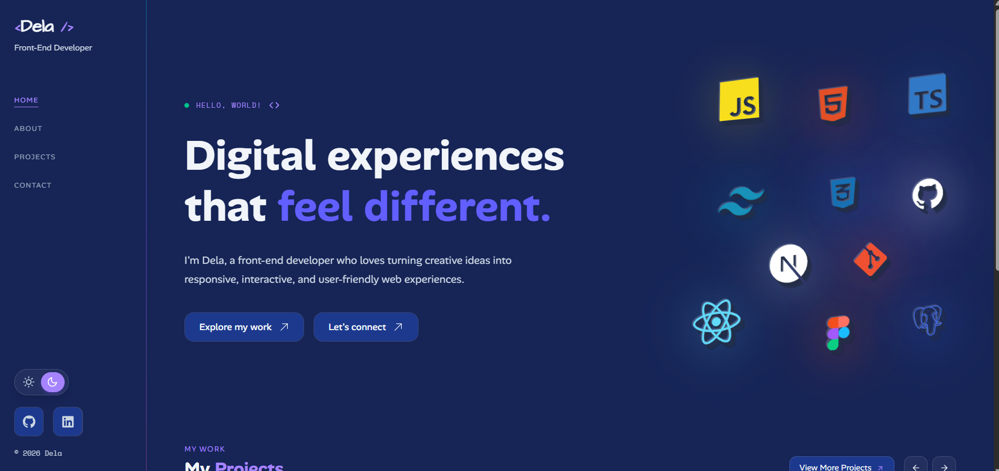

# Front-End Developer Portfolio

A responsive personal portfolio built with React to showcase my projects, technical skills, and approach to front-end development.

**[Live Demo](https://react-portfolio-seven-ruddy.vercel.app/)**



## Features

- Responsive layout with desktop sidebar and mobile navigation
- Light and dark themes
- Project showcase with filters, slider, and links to live demos and source code
- Subtle entrance and scroll animations using Motion
- Contact form with validation and submission feedback
- Accessible navigation, keyboard focus states, and reduced-motion support

## Tech Stack

React · JavaScript · Vite · Tailwind CSS · React Router · Motion · React Icons

## Run Locally

```bash
git clone <your-repository-url>
cd <your-repository-folder>
npm install
npm run dev
```

## Deployment

Deployed on [Vercel](https://vercel.com/).

---

Designed and developed by **Dela**.
